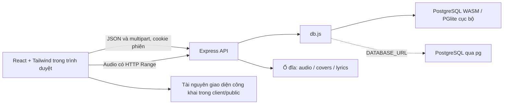

# Kiến trúc SPMusic MVP

Tài liệu nền tảng: [lưu PostgreSQL PGlite trên hệ thống file](https://pglite.dev/docs/filesystems), [cấu hình Vite](https://vite.dev/guide/). Dự án dùng PGlite trong tiến trình Node.js cho bản cục bộ; adapter `pg` dùng khi có `DATABASE_URL`.

## Các lớp chính



Frontend không truy cập database hoặc thư mục upload trực tiếp. API chịu trách nhiệm xác thực, quyền sở hữu, kiểm tra dữ liệu, lưu trữ và cung cấp media. Mã nguồn tách hai npm workspace `client` và `server`; bản phát hành không kèm nhạc mẫu.

## Frontend

`main.jsx` gắn ứng dụng React vào trang HTML. `App.jsx` điều phối các màn hình khám phá, thư viện, tìm kiếm, bài yêu thích, lịch sử, album/nghệ sĩ và playlist. Đây là ứng dụng một trang, các mục điều hướng dùng trạng thái React; không cần cấu hình bộ định tuyến ngoài.

Các thành phần trong `components/` tách giao diện phát nhạc (`Player`), biểu mẫu tài khoản (`AuthModal`), upload/chỉnh sửa (`TrackEditor`), panel lyrics (`LyricsPanel`) và lớp modal dùng chung. Tailwind được tích hợp trực tiếp qua plugin Vite; CSS giao diện bổ sung điều khiển bố cục, màu sắc và các điểm chuyển responsive.

`lib/api.js` tập trung các yêu cầu đến `/api`, gửi cookie phiên và chuẩn hóa thông báo lỗi. Upload dùng tiến trình tải file để hiện phần trăm; trạng thái đạt 100% chuyển sang xử lý phía server trước khi xác nhận thành công.

`lib/usePlayer.js` giữ một phần tử HTML Audio xuyên suốt việc chuyển màn hình. Hook quản lý bài hiện tại, hàng chờ, thời gian, âm lượng, phát ngẫu nhiên và ba chế độ lặp. `timeupdate` từ audio là nguồn thời gian cho thanh tua và lyrics. Hàng chờ lấy theo danh sách đang phát; phát ngẫu nhiên tránh chọn lại chính bài hiện tại khi có nhiều bài.

`lib/lrc.js` chuyển timestamp sang giây, áp dụng offset mili giây, mở rộng nhiều timestamp cùng dòng và sắp xếp kết quả. Hàm tìm dòng dùng tìm kiếm nhị phân, chọn dòng cuối có thời điểm không lớn hơn thời gian phát. `LyricsPanel` làm nổi dòng đó, cuộn trong panel và tôn trọng tùy chọn giảm chuyển động của trình duyệt. Bấm lời gọi hàm tua của audio.

## Tài khoản và quyền dữ liệu

Mật khẩu được băm bằng scrypt với salt ngẫu nhiên riêng. Đăng nhập thành công tạo token phiên ngẫu nhiên; database chỉ lưu SHA-256 của token, cookie giữ token gốc. Cookie là HttpOnly, SameSite=Lax và có thời hạn 7 ngày; thuộc tính Secure tùy cấu hình HTTPS. Đăng xuất thu hồi phiên trong database và xóa cookie.

API lấy `user_id` từ phiên, không tin `ownerId` do client gửi. Mỗi truy vấn sửa/xóa/đọc tài nguyên riêng gắn điều kiện chủ sở hữu. Truy cập bài của tài khoản khác trả lỗi phù hợp thay vì tiết lộ metadata. Playlist và lịch sử chỉ tham chiếu bài của chính chủ.

Thư viện khách trống. Lượt yêu thích nằm trong `localStorage`. Khi đăng nhập, lịch sử/playlist dùng database; lượt yêu thích vẫn ở trình duyệt và được tách khóa theo ID tài khoản.

## Mô hình dữ liệu

| Bảng | Vai trò |
| --- | --- |
| `users` | ID, tên, email duy nhất, hash mật khẩu, thời điểm tạo |
| `sessions` | Hash token, người dùng và thời điểm hết hạn |
| `tracks` | Chủ sở hữu, metadata, thời lượng và tên file audio/cover/lyrics |
| `playlists` | Chủ sở hữu, tên, mô tả và mảng ID bài có thứ tự |
| `listening_history` | Khóa `(owner_id, track_id)` và lần phát gần nhất |

Schema có chỉ mục theo chủ sở hữu và hạn phiên. Truy vấn SQL đều dùng tham số. Lịch sử là danh sách các bài gần đây, không phải nhật ký lưu từng lần nhấn phát. API trả tối đa 50 bài theo lần nghe cuối. Playlist tối đa 1000 ID; các ID trùng bị loại.

Ứng dụng không nạp metadata nhạc mẫu. Các bài do người dùng thêm được lưu trong bảng `tracks` cùng ID chủ sở hữu; bài từ link YouTube có `source_key` để tránh nhập trùng cùng video cho một tài khoản.

## Database và file

`db.js` cung cấp giao diện `query()` và `close()` thống nhất. Khi không có `DATABASE_URL`, PGlite chạy PostgreSQL WASM trong Node và lưu vào `<DATA_DIR>/postgres`. Khi có URL, adapter chuyển sang pool `pg`. Cùng `schema.sql` được khởi tạo trên cả hai.

`DATA_DIR` được giải theo thư mục `server`, mặc định là `server/data`. File chia thành ba thư mục:

```text
server/data/uploads/audio/
server/data/uploads/covers/
server/data/uploads/lyrics/
```

Tên file lưu trữ do server tạo. Audio MP3/WAV PCM/FLAC/ALAC tối đa 250 MB được tải vào `uploads/temp/` trên đĩa; ảnh JPG/PNG/WebP tối đa 5 MB và LRC UTF-8 tối đa 256 KB được đọc sau kiểm tra dung lượng. FFprobe kiểm tra codec và FFmpeg giải mã để xác minh dữ liệu. ALAC tạo thêm bản FLAC trong `uploads/playback/`, bản gốc lưu ở `uploads/audio/`. Lỗi hoặc thành công đều dọn thư mục tạm; tối đa hai lượt upload đồng thời. Các cột schema mới được thêm bằng ALTER TABLE IF NOT EXISTS để giữ dữ liệu cũ.

AI lyrics chạy trong tiến trình con riêng, dùng Whisper đa ngôn ngữ trên CPU với mô hình lưu tại `DATA_DIR/ai-models/`. Máy chủ giữ tác vụ riêng từng chủ sở hữu, frontend hỏi trạng thái và cho xem/chỉnh bản nháp trước khi lưu LRC. Âm thanh AI mono 16 kHz là bản tạm, không thay đổi âm thanh phát. Xem [LOCAL-AI.md](LOCAL-AI.md).

File riêng không được mở bằng đường dẫn static. `/api/media/:id/audio` và `/api/media/:id/cover` kiểm tra phiên/chủ sở hữu rồi gửi file; audio hỗ trợ HTTP Range để tua. `/api/tracks/:id/lyrics` trả nội dung LRC được phép đọc. Xóa bài dọn file kèm tham chiếu trong playlist/lịch sử của chủ sở hữu.

Database và ổ đĩa là hai hệ thống lưu trữ riêng; thao tác giữa chúng không có giao dịch phân tán. Khi phát triển tiếp, nên có tác vụ đối soát file mồ côi/thiếu file và cơ chế sao lưu thống nhất. Với PGlite, dừng backend trước khi sao lưu thư mục dữ liệu; với PostgreSQL độc lập, sao lưu database và file cần được phối hợp.

## Chạy và mở rộng

Phát triển dùng Vite cổng 5173 và Express cổng 3001, proxy `/api` để giữ luồng cookie đơn giản. Sau `npm run build`, Express phục vụ `client/dist`, cho phép chạy toàn bộ bằng `npm start` tại cổng 3001. Cấu hình mặc định chỉ lắng nghe loopback; không có bước xuất bản lên Internet.

Các hướng mở rộng đã có điểm tách rõ: thay adapter database bằng `DATABASE_URL`, tách các route trong `app.js` thành controller/service, chuyển file sang object storage, thêm xử lý media bất đồng bộ, quota, khôi phục mật khẩu và migration có phiên bản. Trước khi mở public cần thiết kế HTTPS, vận hành phiên, giới hạn tải, giám sát và sao lưu theo mô hình triển khai thực tế.
